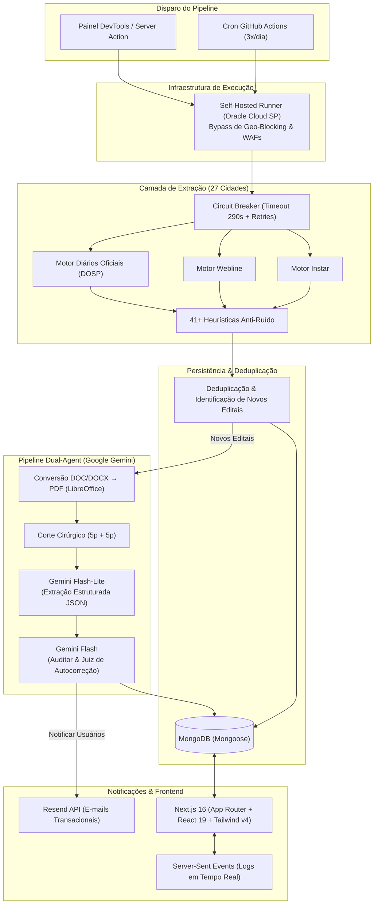

<div align="center">

# 📋 Radar de Editais (Achador de Editais)

**Plataforma Full-Stack de Inteligência e Monitoramento Automatizado de Concursos Públicos Municipais com IA Generativa (Dual-Agent)**

[](https://nextjs.org/)
[](https://react.dev/)
[](https://www.typescriptlang.org/)
[](https://www.mongodb.com/)
[](https://ai.google.dev/)
[](https://tailwindcss.com/)
[](https://github.com/features/actions)
[](https://resend.com/)

<p align="center">
  Sistema autônomo que rastreia, audita, categoriza e notifica sobre editais de concursos públicos e processos seletivos de <b>27 cidades</b> (prefeituras e câmaras) da região noroeste do estado de São Paulo, além de monitorar movimentações de servidores federais do IBGE via Portal da Transparência.
</p>

</div>

---

## 🎯 O Problema & A Solução

* **O Desafio**: Portais de prefeituras e diários oficiais municipais são descentralizados, possuem estruturas heterogêneas, utilizam formatos variados (PDFs, DOC/DOCX, páginas dinâmicas), sofrem com indisponibilidades frequentes e aplicam firewalls rígidos (WAFs com bloqueio de IPs internacionais). A busca manual por novos concursos é demorada, suscetível a ruídos burocráticos (licitações misturadas com seleções) e ineficiente.
* **A Solução**: Uma plataforma completa que unifica a extração de dados através de múltiplos motores de scraping especializados, supera bloqueios geográficos via infraestrutura dedicada, processa e enriquece os documentos utilizando **dois agentes de Inteligência Artificial do Google Gemini** (extração + auditoria/autocorreção) e notifica usuários cadastrados em tempo real por e-mail.

---

## 🌟 Destaques de Engenharia & Diferenciais Técnicos

### 1. 🛡️ Bypass de Geo-Blocking & WAFs Municipais
Muitos portais governamentais brasileiros bloqueiam conexões originadas fora do país (retornando `HTTP 403 Forbidden`). Os runners padrão do GitHub Actions operam no exterior e são bloqueados. Para solucionar isso, o pipeline foi arquitetado utilizando um **Self-Hosted Runner do GitHub Actions hospedado na nuvem (Oracle Cloud Infrastructure)** localizado em **São Paulo (IP brasileiro)**, garantindo 100% de taxa de sucesso nas requisições governamentais.

### 2. 🤖 Pipeline Dual-Agent com IA Generativa (Google Gemini)
Em vez de depender apenas de expressões regulares frágeis para documentos não estruturados, o sistema utiliza uma abordagem com dois agentes de IA:
* **Agente de Extração (Gemini Flash-Lite - `gemini-flash-lite-latest`)**: Lê o documento oficial via Google GenAI Interactions API e extrai um JSON estruturado contendo: título normalizado, resumo do edital, identificador do concurso e data de publicação.
* **Agente Auditor (Gemini Flash - `gemini-flash-latest`)**: Quando ocorrem alterações significativas entre o edital raspado e os dados gerados, atua como juiz, emitindo veredicto (`CORRETO` ou `INCORRETO`) e aplicando correções automáticas em memória antes da persistência no banco.

### 3. ⚡ Otimização Cirúrgica de Tokens & Custos
* **Corte Inteligente de Páginas**: Editais governamentais frequentemente têm dezenas ou centenas de páginas. O sistema implementa uma heurística que extrai apenas as **5 primeiras páginas** (regras, abertura, cargos) e as **5 últimas páginas** (cronograma, assinaturas e datas), reduzindo o consumo de tokens e o tempo de resposta em mais de 75%.
* **Conversão DOC/DOCX $\to$ PDF On-The-Fly**: Arquivos em formato Word são convertidos em tempo real para PDF utilizando LibreOffice headless (`soffice`), permitindo upload direto para a API multimodal do Gemini Files API.
* **Telemetria e Custos**: Monitoramento em tempo real do custo estimado de processamento (USD $\to$ BRL com conversão cambial dinâmica).

### 4. 🔄 Motor de Scraping Resiliente & Modular
* **27 Cidades e Órgãos Rastreados**: Suporte a portais de sistemas *Instar*, *Webline*, Diários Oficiais Eletrônicos (*DOSP* e *Diário Transparente*) e Câmaras Legislativas.
* **Circuit Breaker & Timeout**: Cada cidade roda com proteção de timeout isolado (290s), garantindo que a falha ou lentidão de um portal municipal não trave a execução das demais cidades.
* **Retentativas Inteligentes**: Até 3 rodadas de re-execução apenas para municípios que reportaram instabilidade temporária.
* **Filtros Anti-Ruído Burocrático**: Mais de 41 heurísticas regex descartam atos puramente burocráticos (atas de abertura, compras, convocações, pregões e licitações ordinárias) para manter o feed focado em editais de abertura e andamento relevante.

### 5. 🏛️ Módulo Federal (IBGE - SIAPE 45205)
* Módulo secundário integrado à API de Dados do **Portal da Transparência do Governo Federal**.
* Sincronização diária automatizada de servidores do órgão, detecção de alterações funcionais (cargo, situação, regime de trabalho, lotação) e disparo de relatórios administrativos.

---

## 🏗️ Arquitetura do Sistema



---

## 💻 Interfaces & Recursos Visuais

| Recurso | Descrição |
|---|---|
| **Visualização em Pastas (Folder View)** | Agrupa documentos e retificações sob uma pasta virtual do respectivo concurso público. |
| **Visualização Linear (List View)** | Feed cronológico de editais com badges de cidade, órgão, status e datas. |
| **Painel de Filtros Avançados** | Busca textual global, filtros por município, ano, órgão (Prefeitura vs Câmara), status e exibição de licitações. |
| **Terminal SSE em Tempo Real** | Streaming contínuo de logs de execução do backend diretamente no navegador via Server-Sent Events (modo dev). |
| **Painel Administrativo DevTools** | Gatilhos manuais para disparar raspagens seletivas, alternar IA/e-mails, forçar auditoria e simular cenários. |
| **Painel de Métricas (/developer/logs)** | Histórico analítico das últimas 20 execuções do scraper com status, duração e contagem de itens. |

---

## 🗺️ Cobertura: 27 Cidades e Órgãos Monitorados

<details>
<summary><b>Clique para expandir a lista de prefeituras e câmaras</b></summary>

### Prefeituras Municipais (20):
* Fernandópolis
* Votuporanga
* Jales
* Ouroeste
* Macedônia
* Estrela d'Oeste
* Guarani d'Oeste
* Meridiano
* São João das Duas Pontes
* Pedranópolis
* Mira Estrela
* Indiaporã
* Álvares Florence
* Parisi
* Valentim Gentil
* Vitória Brasil
* Urânia
* Dolcinópolis
* Pontalinda
* Santa Salete

### Câmaras Municipais (7):
* Fernandópolis (Câmara)
* Mira Estrela (Câmara)
* Indiaporã (Câmara)
* Parisi (Câmara)
* Jales (Câmara via Diário Oficial)
* Votuporanga (Câmara via Diário Oficial)
* Meridiano (Câmara via Diário Oficial)

</details>

---

## 🛠️ Stack Tecnológica

* **Frontend**: Next.js 16 (App Router, Server Actions, React 19), Tailwind CSS v4, Lucide React, React Hook Form, Zod.
* **Backend & API**: Next.js Server Actions, Route Handlers, Server-Sent Events (SSE).
* **Banco de Dados**: MongoDB (Mongoose) com cache de conexões para ambientes serverless.
* **Inteligência Artificial**: Google Gemini API (`@google/genai` - Interactions API) — modelos `gemini-flash-lite-latest` (extração) e `gemini-flash-latest` (auditoria).
* **Processamento de Documentos**: `pdf-lib`, `pdfjs-dist`, `mammoth`, `word-extractor`, `cheerio`, LibreOffice headless (`soffice`).
* **Segurança & Auth**: JWT assinado (`jose`), hashing com `bcryptjs`, cookies HttpOnly / Secure.
* **Comunicação**: Resend (API de e-mails transacionais).
* **CI/CD & Automação**: GitHub Actions com Self-Hosted Runner (Oracle Cloud).

---

## 🚀 Como Executar o Projeto

### Pré-requisitos
* **Node.js 24+**
* **MongoDB** (local ou cluster MongoDB Atlas)
* **LibreOffice** (opcional para desenvolvimento básico; necessário para conversão DOC$\to$PDF local)
* Chaves de API: Google Gemini, Resend, Portal da Transparência (opcional).

### Passo a Passo

1. **Clone o repositório:**
   ```bash
   git clone https://github.com/<seu-usuario>/achadordeeditais.git
   cd achadordeeditais
   ```

2. **Instale as dependências:**
   ```bash
   npm install
   ```

3. **Configure as variáveis de ambiente:**
   ```bash
   cp .env.example .env.local
   ```
   Abra o arquivo `.env.local` e preencha as variáveis com suas credenciais (consulte as instruções comentadas no arquivo).

4. **Inicie o servidor de desenvolvimento:**
   ```bash
   npm run dev
   ```
   Acesse a aplicação em [http://localhost:3000](http://localhost:3000).

---

## ⚙️ Scripts Disponíveis

| Comando | Descrição |
|---|---|
| `npm run dev` | Inicia o servidor Next.js em modo de desenvolvimento |
| `npm run build` | Executa o build de produção |
| `npm run start` | Inicia o servidor em modo de produção |
| `npm run lint` | Executa a verificação de código com ESLint |
| `npm run db:backup` | Gera backup completo de todas as coleções do MongoDB em formato EJSON |
| `npx tsx scripts/run-scraper.ts` | Executa o pipeline completo de raspagem (utilizado pelo GitHub Actions) |
| `npx tsx scripts/sync-ibge.ts` | Executa a sincronização de servidores federais do IBGE |
| `npx tsx scripts/initScraperConfigs.ts` | Inicializa as configurações padrão dos scrapers no MongoDB |
| `npx tsx scripts/testScraper.ts` | Testa a raspagem isolada de um município |

---

## 📂 Estrutura de Diretórios

```text
├── .github/workflows/       # Workflows de automação do GitHub Actions
├── scripts/                 # Scripts operacionais (raspagem, sync IBGE, backups)
├── src/
│   ├── app/                 # App Router (Páginas, Rotas de API e Server Actions)
│   │   ├── admin/           # Server Actions para painel administrativo
│   │   ├── api/             # Endpoints (SSE Dev Logs, Módulo IBGE)
│   │   ├── auth/            # Server Actions de autenticação e conta
│   │   ├── developer/logs/  # Visualizador de métricas dos scrapers
│   │   ├── profile/         # Gestão de perfil e preferências de notificação
│   │   └── servidoresIBGE/  # Painel de busca e remuneração de servidores federais
│   ├── components/          # Componentes React (ListView, FolderView, DevTools, etc.)
│   ├── lib/
│   │   ├── aiAnalysis.ts    # Agente 1: Extração estruturada via Gemini Flash-Lite (gemini-flash-lite-latest)
│   │   ├── aiAuditor.ts     # Agente 2: Auditoria e autocorreção via Gemini Flash (gemini-flash-latest)
│   │   ├── auth.ts          # Utilitários JWT (jose) e bcrypt
│   │   ├── docParser.ts     # Download e extração de texto/metadados em documentos
│   │   ├── email.ts         # Wrapper de envio de e-mails via Resend
│   │   ├── orchestrator.ts  # Orquestrador central do pipeline de ponta a ponta
│   │   ├── runner.ts        # Executor resiliente com timeout e retentativas
│   │   ├── storage.ts       # Camada de persistência e deduplicação no MongoDB
│   │   ├── wordToPdf.ts     # Conversão DOC/DOCX → PDF via LibreOffice headless
│   │   └── scrapers/        # Módulos de raspagem de cada município e câmara
│   ├── models/              # Schemas Mongoose (Edital, User, ScrapingLog, etc.)
│   └── types/               # Tipagens TypeScript
├── .env.example             # Template documentado de variáveis de ambiente
├── .gitignore               # Regras de exclusão do Git
├── ESTRUTURA.md             # Documentação aprofundada da arquitetura
└── README.md                # Apresentação principal do projeto
```

---

## 📄 Licença

Este projeto é disponibilizado sob a licença [MIT](LICENSE).

---

<div align="center">
  <sub>Desenvolvido com foco em engenharia resiliente, eficiência de tokens e arquitetura moderna de software.</sub>
</div>
